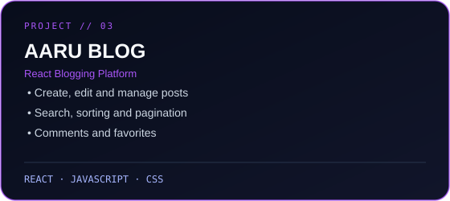
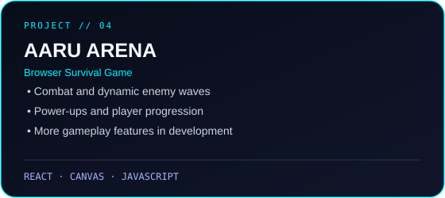
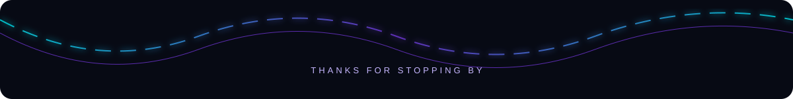

<p align="center">
  
</p>

<p align="center">
  
</p>

<p align="center">
  <a href="https://reactportfolio-one-lemon.vercel.app/"></a>
  <a href="https://www.linkedin.com/in/aravind-padmanabhan-2b8a7b419/"></a>
  <a href="https://github.com/newaarurgb"></a>
</p>

<p align="center">
  
</p>


## `01 / ABOUT ME`

I'm **Aravind Padmanabhan**, a Computer Science and Artificial Intelligence student at **IIITDM Kancheepuram**, focused on full-stack development and practical software projects.

- 💻 Building web applications with Python, Django, React, and MySQL.
- 🧩 Interested in APIs, database design, responsive interfaces, and deployment.
- 🧠 Exploring AI, Machine Learning, and Deep Learning.
- 🏸 Outside tech: badminton, creative writing, and storytelling.

```python
class Aravind:
    role = "Full Stack Python Developer"
    stack = ["Python", "Django", "React", "JavaScript", "MySQL"]
    interests = ["Full Stack Development", "AI", "Machine Learning"]

    def next_step(self):
        return "Keep learning. Build useful things. Ship consistently."
```


## `02 / TECH STACK`

<p align="center">
  
</p>

<p align="center">
  
  
  
</p>


## `03 / FEATURED PROJECTS`

<p align="center">
  
  
</p>

<p align="center">
  
  
</p>

| Project | Overview | Technologies |
|---|---|---|
| **Learnova** | LMS with student/trainer authentication, course enrollment, resources, assignments, and progress tracking. | React, Django REST Framework, MySQL |
| **StayEase** | Hotel discovery and booking platform with availability, reviews, wishlists, and account features. | Python, Django, MySQL |
| **AARU Blog** | Blogging app with post management, search, filtering, sorting, pagination, comments, and favorites. | React, JavaScript, HTML, CSS |
| **AARU Arena** | Browser survival game with combat, enemy waves, power-ups, and player progression. | React, JavaScript, HTML5 Canvas |

<p align="center">
  <a href="https://aaru-arena1.vercel.app/"></a>
  <a href="https://github.com/newaarurgb?tab=repositories"></a>
</p>

> **Project links:** Visit the repositories tab on my GitHub profile to find the projects. Add direct repository links to each card once the exact repository URLs are confirmed.


## `04 / GITHUB ANALYTICS`

<p align="center">
  
  
</p>

<p align="center">
  
</p>

<p align="center">
  
</p>


## `05 / CURRENT FOCUS`

<p align="center">
  
</p>

- Strengthening Python and Data Structures & Algorithms.
- Building more robust full-stack applications.
- Exploring AI and Machine Learning projects.
- Improving testing, deployment, and software architecture skills.


## `06 / LET'S CONNECT`

<p align="center">
  <a href="https://github.com/newaarurgb"></a>
  <a href="https://www.linkedin.com/in/aravind-padmanabhan-2b8a7b419/"></a>
  <a href="https://reactportfolio-one-lemon.vercel.app/"></a>
</p>

<p align="center"><i>“Build with curiosity. Improve with consistency.”</i></p>

<p align="center">
  
</p>
